# Assets
OpenMS is currently in the process of rebranding! Information on the current design schema can be found in [OpenMS_CorporateDesign_current.pdf](https://github.com/OpenMS/Assets/blob/master/OpenMS_CorporateDesign_current.pdf)

## Web app logos

Each OpenMS web app has its own folder under `logos/webapps/<app>/`, all vector (SVG) except an older PNG where one exists:

| File | What it is |
|---|---|
| `<app>-mark-light.svg` | the mark (rays and glyph) on a transparent background, **for light backgrounds** (dark glyph) |
| `<app>-mark-dark.svg` | the same mark **for dark backgrounds** (white glyph) |
| `<app>-mark-animated-light.svg`, `<app>-mark-animated-dark.svg` | the mark animated: the rays grow in, then pulse outward with the dots riding on their tips. Self-contained CSS, no script, so it plays in an `` tag, a README or a website; it stays still where the viewer asks for reduced motion |
| `<app>-icon.svg`, `<app>-icon-small.svg` (and `-light`) | app icon tiles, dark and light |
| `<app>-logo-horizontal.svg`, `<app>-logo-stacked.svg` (and `-light`, `-white`) | mark with the app name, side by side or stacked |

`light` and `dark` always name the background the file is made for.

Example in a README:

```html
<picture>
  <source media="(prefers-color-scheme: dark)" srcset="https://raw.githubusercontent.com/OpenMS/Assets/master/logos/webapps/flashapp/flashapp-mark-animated-dark.svg">
  
</picture>
```

The desktop apps' loading screen draws the static marks with the same motion (`loading_logo` in an app's `settings.json`).

## Animated OpenMS logo

`logos/OpenMS-logo-animated-light.svg` (for light backgrounds) and `logos/OpenMS-logo-animated-dark.svg` (for dark backgrounds) play the desktop apps' loading animation: the baseline draws, the peaks grow out of it one after another, the letters fade in, a sheen passes over the peaks, and then the peaks keep moving. Like the marks above it is self-contained CSS in one vector file, works in an `` tag, and stays still where the viewer asks for reduced motion.

```html
<picture>
  <source media="(prefers-color-scheme: dark)" srcset="https://raw.githubusercontent.com/OpenMS/Assets/master/logos/OpenMS-logo-animated-dark.svg">
  
</picture>
```
